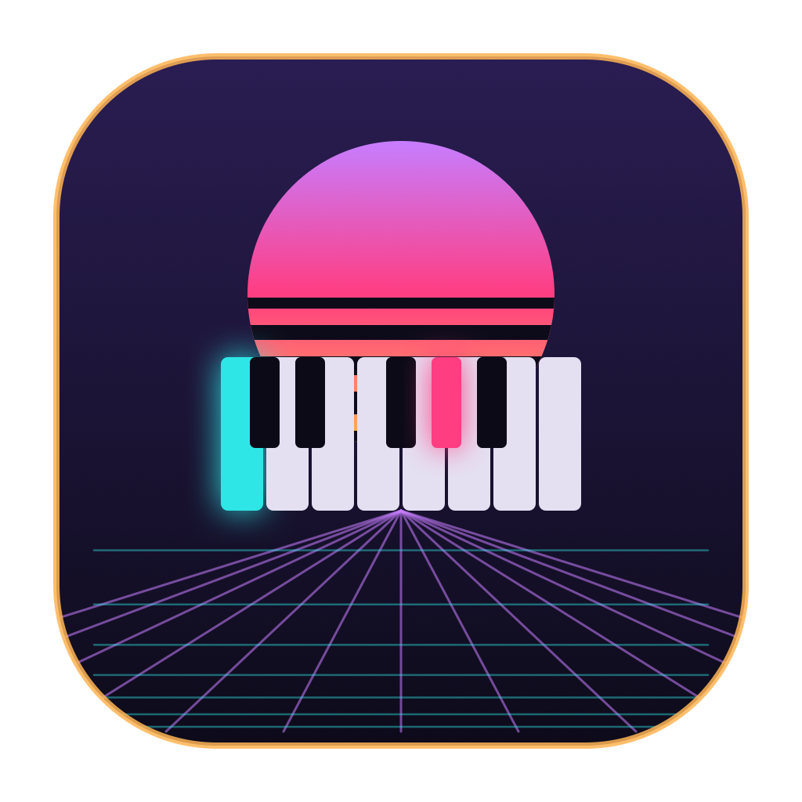

# Keytarist

A native macOS app that visualizes the **Rock Band 3 keyboard (PS3 "keytar")**
as you play it: a live on-screen piano, the note names you're holding, real-time
chord detection, and a built-in polyphonic synth with switchable sound palettes.

This is a standalone SwiftUI app living alongside the Python tooling in the
[`rb3_keytar`](../) repo. It talks to the keyboard **directly over USB-HID** — no
MIDI, no Python, no external dependencies.



## Features

- **Live piano** — 25 keys (C1–C3) light up as you play (teal white keys, pink
  black keys, neon glow).
- **Note readout** — the exact notes currently held.
- **Chord detection** — inversion-aware triads (major / minor / dim / aug /
  sus2 / sus4) plus octave / interval / cluster shapes. Ported from the repo's
  `mood_map.py`.
- **Built-in synth** — one voice per key, additive/click-free, with a master
  volume. Zero soundfont files (AVAudioEngine + a custom render node).
- **Sound palettes** — Pad / Saw Lead / Square Reed / Bell / Organ. Cycle them
  with the **button on the keytar's handle**, or the on-screen *Palette* button.
- **NeonDeco** styling (synthwave art-deco), vendored from `nthmost-systems`.

## Build & run

Command Line Tools only — no full Xcode required.

```bash
cd keytarist
./scripts/build.sh      # compiles + assembles build/Keytarist.app
./scripts/run.sh        # build + open
```

Regenerate the icon after editing `scripts/make-icon.swift`:

```bash
swift scripts/make-icon.swift      # -> /tmp/keytarist_icon.png
cp /tmp/keytarist_icon.png icon-1024.png
./scripts/icon.sh                  # -> Resources/AppIcon.icns (ImageIO)
./scripts/build.sh
```

### Permissions

The keyboard is a generic HID device. If the app shows "Waiting for the keytar"
while it's plugged in, grant **Keytarist** access under *System Settings →
Privacy & Security → Input Monitoring*, then relaunch.

## How the HID layer works (hard-won notes)

The keyboard enumerates as a Sony-licensed HID gamepad — **VID `0x12ba` /
PID `0x2330`** — not as a MIDI device, so CoreMIDI never sees it. `KeytarHID.swift`
opens it with `IOHIDManager` on a dedicated background run-loop thread and parses
raw input reports. Three things that cost real debugging time:

1. **Handshake needs a settle delay.** The keyboard only streams clean key data
   after a 40-byte **Feature** report (`SET_REPORT`, report type 3, id 0). Sending
   it immediately after `IOHIDDeviceOpen` doesn't take — a ~50 ms `usleep` before
   the `IOHIDDeviceSetReport` is required. Before the handshake lands, bytes 3–6
   read as analog sticks centered at `0x80` (which looks like phantom C1 + G#1);
   after it, bytes 5/6/7 are the clean 25-key bitmask.
2. **Don't send the handshake as an Output report unless Feature fails.** On this
   controller an Output `SET_REPORT` also drives the player LEDs, so sending the
   handshake blob that way leaves them blinking red. Feature-only is clean.
3. **The HID report is high-rate (~100+ Hz).** Updating SwiftUI per report pegs
   the main thread — read on a background thread and only publish on *change*.

### Report byte layout (report id 0)

| bytes      | meaning                                             |
|------------|-----------------------------------------------------|
| 5, 6, 7    | key bitmask, keys 0–23 (bit 7 = lowest key of each) |
| 8 (bit 7)  | key 24 (top C)                                      |
| 8, 9, 10   | per-key velocity (not yet used by the UI)           |
| 13 (bit 7) | **handle button** → cycles sound palettes           |
| 15         | touch strip (analog; unused for now)                |

## Layout

```
keytarist/
  Package.swift            # SPM; depends on vendored ./NeonDeco
  Sources/App/
    AppMain.swift          # @main scene
    AppState.swift         # owns the HID reader + synth, publishes UI state
    KeytarHID.swift        # IOHIDManager: open, handshake, parse reports
    Music.swift            # note names + chord classification
    SynthEngine.swift      # polyphonic additive synth + palettes
    PianoView.swift        # the on-screen keyboard
    MainWindow.swift       # window UI
  NeonDeco/                # vendored design-system snapshot
  scripts/                 # build.sh, run.sh, icon.sh, make-icns.swift, make-icon.swift
  icon-1024.png            # app icon source
```
